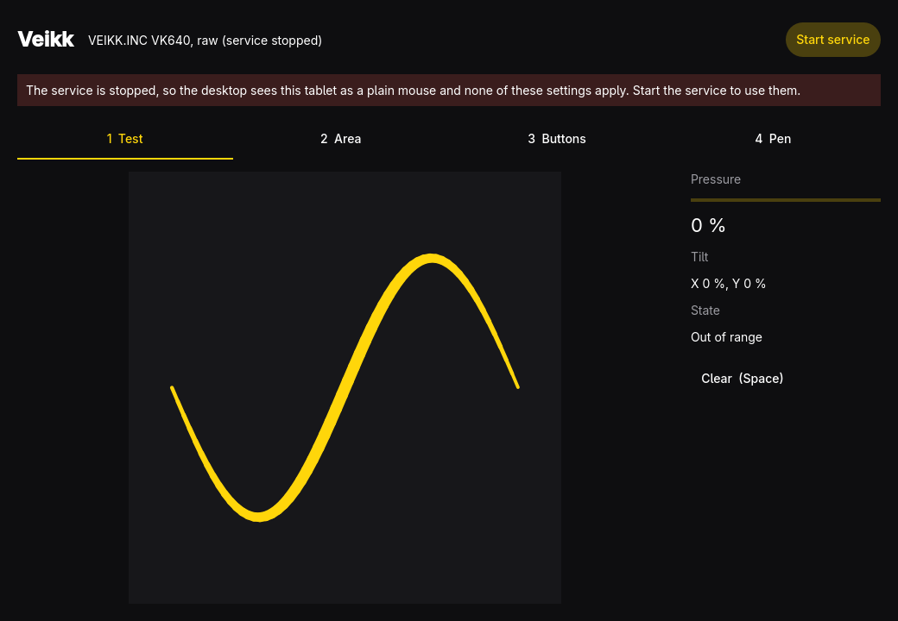

# veikk

Set up a Veikk drawing tablet on Omarchy: which part of the pad is used, which
monitor it drives, how pressure feels, and what the pad buttons send.

Built and tested against the VK640 (USB `2feb:0005`). Other Veikk pads use the
same standard HID reports and may work, but have not been tried.

> **Unofficial project.** veikk is an independent, community-made tool. It is not
> made, endorsed or supported by Veikk (VEIKK / Shenzhen Veikk), and "Veikk" and
> "VK640" are used only to say which hardware it works with. It comes with no
> warranty (see `LICENSE`): the service grabs the tablet's input devices while it
> runs, so use it at your own risk.

## Why it exists

Hyprland does not register the VK640's pen as a tablet, only its mouse and
keyboard interfaces, so none of Hyprland's `input:tablet:*` options reach it.
`veikkd` grabs the real pen and pad keys and re-emits them through a
virtual tablet (`Veikk Virtual Tablet`) and keypad that Hyprland does
recognise. Everything is done in software through evdev and uinput: nothing is
ever written to the tablet itself.

## Use

```sh
veikk           # the window
veikkd          # the service the window starts and stops (veikk daemon runs it too)
veikk status    # add --json for scripts; exits 3 when the service is not running
veikk --version
```

After installing the package, **log out and back in once**: the udev rule gives
your session access to the tablet and to `/dev/uinput`, and that only applies
to new sessions.

Press **Start service** in the window; it runs `systemctl --user enable --now
veikk.service`. Settings live in `~/.config/veikk/config.json` and the daemon
applies every change as soon as it is saved.

The official `vktablet` driver also takes the tablet over, so do not run both.

### Hyprland's own options

Once the service runs, Hyprland lists `veikk-virtual-tablet` under tablets, so
its options work too, for example in `~/.config/hypr/input.lua`:

```lua
hl.device({ name = "veikk-virtual-tablet", output = "DP-1" })
```

veikk already spreads the pen over the monitor you pick, so you only need that
if you prefer Hyprland to own the monitor choice. Leave the window's monitor on
"All monitors" in that case.

## Placing the pad on the screen

The Area page draws the screen as the background and the pad as a rectangle on
it. Drag the rectangle to choose where on the monitor the pad acts, and its
corner to resize it; the arrow keys move it and Shift+arrows resize it. With
**Keep proportions** the rectangle keeps the pad's shape, so a circle drawn on
the pad stays a circle. The small picture under it picks which part of the pad
is used.

## Real size

Turn on **Real size (1:1)** on the Area page and the pad is drawn at its
physical size on the monitor: a centimetre on the pad is a centimetre
on the screen. The monitor's size comes from Hyprland (`hyprctl monitors`), and
the pad's from **Pad width (mm)**, which starts at 152.4 mm (6 in, the VK640)
because the pad reports no size of its own; the height follows the pad's
width ÷ height. If the screen is smaller than the pad along an axis, only the
middle part of the pad that fits is used. With "All monitors" it uses the first
monitor. If a screen reports no physical size, the area stays as set by hand.

## Omarchy bar widget

`plugins/afm.veikk/` holds an optional [Omarchy shell](https://omarchy.org)
bar widget (`bar-widget`, id `afm.veikk`). It shows whether the service is
running, the tablet it found and any problem the service reports, and lets you
adjust the working area from the bar. It reads `veikk status --json` and
`~/.config/veikk/config.json`, and starts or stops the service with
`systemctl --user`; its "open" button runs `veikk open`.

Install it by copying the folder and enabling it in the shell config:

```sh
mkdir -p ~/.config/omarchy/plugins
cp -r plugins/afm.veikk ~/.config/omarchy/plugins/
```

Then add `{ "id": "afm.veikk" }` to one of the bar's sections in
`~/.config/omarchy/shell.json` (for example `centerBegin`; its default is the
right side) and restart the shell. It needs `veikk` on the `PATH` and `jq`; the refresh interval and the pad's
physical size (152.4 x 101.6 mm by default, the VK640) are options in its
manifest. It is MIT licensed like the rest and not part of the Arch package.

## Security

The service needs `/dev/uinput` to create its virtual devices, so the udev rule
(`pkgbuild/70-veikk.rules`) gives the logged-in user access to it with
`uaccess`. Any program running as you can then create input devices too, the
same exposure as `ydotool`. It also gives you the tablet's own input nodes,
including the pad's keyboard interface. Nothing is granted to other users or
groups. `veikk.service` runs with `NoNewPrivileges`, a restricted syscall and
address-family set, and no write access beyond your own files.

## Shortcuts

| Key | Action |
| --- | --- |
| `1` – `4` | Switch page |
| `Space` | Clear the test canvas |
| `Ctrl+Z` / `Ctrl+Shift+Z` | Undo / redo a setting |
| `?` | Show the shortcuts |
| `Q` | Quit |

## Build

```sh
bin/build      # build/veikk (window) and build/veikkd (service)
bin/test       # unit tests, offscreen
bin/install    # makepkg -fsi, so it shows up in the launcher
```

Needs `qt6-base`, `qt6-declarative` and `qt6-wayland`. The service links only
Qt Core. `qmake6 veikk.pro VERSION=x.y.z PREFIX=/usr && make install` also works
(set `INSTALL_ROOT` to stage it).

## Troubleshooting

- `veikk status` lists the tablet's devices and whether the service runs.
  `journalctl --user -u veikk` shows what the service said.
- "Cannot open /dev/input/eventN": the udev rule has not reached your session
  yet. Log out and back in, or run `udevadm trigger --subsystem-match=input`
  and replug the tablet.
- "Cannot open /dev/uinput": same cause, for the virtual devices.
- The monitor list is empty or the pad maps to everything: the service could
  not run `hyprctl`. It needs `HYPRLAND_INSTANCE_SIGNATURE` in the systemd user
  environment; Omarchy's session start imports it. Check with
  `systemctl --user show-environment | grep HYPRLAND`.
- "another daemon is already running": a second `veikkd` exits with status 2 and
  leaves the first alone. Stop the other one (or the official `vktablet`).

## Files

- `~/.config/veikk/config.json`: written by the window, watched by the service.
  Fields: `monitor`, `rotation`, `area{x,y,w,h}` (the part of the pad), `target{x,y,w,h}` (where on the
  monitor), `keepProportions`,
  `tabletAspect`, `curve{x1,y1,x2,y2}`, `barrel`, `buttons[{from,to}]`.
  Missing or invalid values fall back to the defaults.
- `$XDG_RUNTIME_DIR/veikk/state.json`: written by the service: `pen`, `keypad`,
  `problem` (plus `problemFormat`/`problemArgs` for translation), `chord` and
  `sequence`. `daemon.lock` in the same folder is held while the service runs.

## Limits

- Monitor selection needs Hyprland (`hyprctl`). Under another compositor the pad
  maps to the whole desktop.
- Pressure, area and buttons are applied by the service, so they stop applying
  if it stops, and the pad goes back to behaving as the desktop saw it before.
- The tablet's own on-board settings (the proprietary `hidraw` channel the
  official driver uses) are not touched.
- A pad button is remapped by the keys it types. A chord that two buttons both
  type cannot be told apart.
